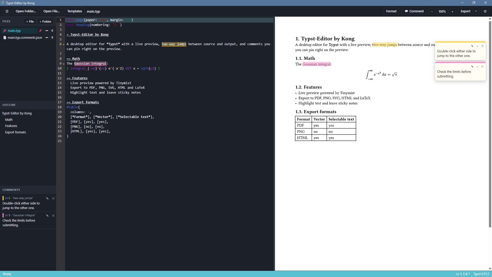

# Typst-Editor by Kong

A desktop editor for [Typst](https://typst.app) documents on Windows, with a live preview, two-way jumps between the source and the output, and comments you can pin right on the preview.



## Features

- **Editor**: Typst syntax highlighting, autocomplete, go to definition (F12), formatting (Shift+Alt+F), word wrap, autosave. Language features come from [Tinymist](https://github.com/Myriad-Dreamin/tinymist).
- **Live preview**: renders as you type. Double-click either side to jump to the matching spot in the other, which flashes orange for 2 seconds. Zoom with the toolbar, Ctrl+scroll or Ctrl+= / Ctrl+-.
- **Comments on the preview**: turn on 💬 Comment, pick a highlight color, drag over text in the preview and write a sticky note. The same text is highlighted in the editor. Comments are saved next to the file (`<file>.typ.comments.json`) and follow their text as you edit.
- **Project workspace**: file tree with folders you can fold, outline, problems panel, quick open (Ctrl+P), pin a main file, and an image viewer.
- **Export**: PDF, PNG, SVG, HTML and LaTeX.
- **Templates**: browse the Typst Universe templates, or save your own documents as templates.
- **Bundled fonts**: TeX Gyre Termes is provided to the compiler, preview and export.

## Keyboard shortcuts

| Shortcut | Action |
| --- | --- |
| Ctrl+O | Open file |
| Ctrl+P | Quick open |
| Ctrl+S | Save |
| Ctrl+E | Export PDF |
| Ctrl+B | Toggle sidebar |
| Shift+Alt+F | Format document |
| F12 | Go to definition |
| Ctrl+= / Ctrl+- / Ctrl+0 | Zoom preview in / out / reset |

## Building from source

Requirements: Windows 10/11 (x64), [Node.js](https://nodejs.org) 20+, [Rust](https://rustup.rs), and the [Tauri prerequisites](https://tauri.app/start/prerequisites/) (WebView2 and the MSVC build tools).

1. Download Tinymist `v0.15.12` (`tinymist-x86_64-pc-windows-msvc.zip`) from its [release page](https://github.com/Myriad-Dreamin/tinymist/releases/tag/v0.15.12) and put `tinymist.exe` in `tools/`. See [tools/README.md](tools/README.md).
2. Install dependencies and run the app:

   ```bash
   npm install
   npm run tauri dev
   ```

3. Run the tests:

   ```bash
   npm test
   ```

4. Build the installer (written to `src-tauri/target/release/bundle/`):

   ```bash
   npm run tauri build
   ```

## Project layout

- `src/`: the front end (TypeScript, CodeMirror 6).
- `src-tauri/`: the Tauri back end (Rust): file access, the Tinymist bridge, export. `src-tauri/src/preview_flash.js` is injected into the preview page.
- `tools/`: the pinned Tinymist binary, bundled fonts and release scripts.

## License

[MIT](LICENSE) © 2026 Kong.

Third-party components keep their own licenses: [Tinymist](https://github.com/Myriad-Dreamin/tinymist) (Apache-2.0), bundled with the app as `tinymist.exe`, and the TeX Gyre Termes fonts in `tools/fonts/` ([GUST Font License](https://www.gust.org.pl/projects/e-foundry/licenses)).
